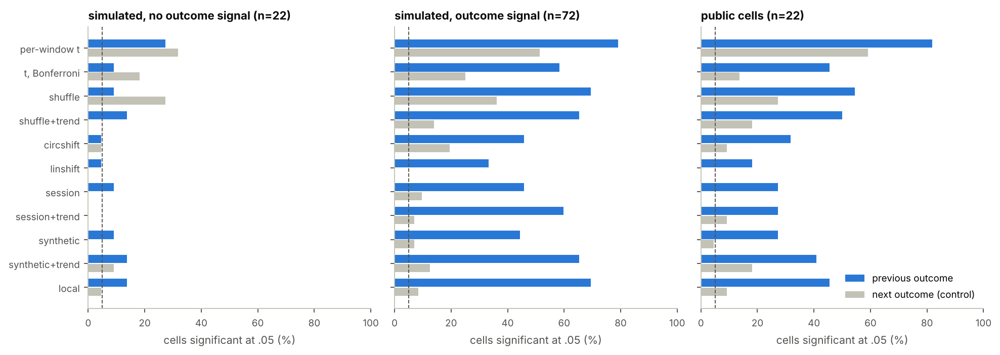

# Purkinje cells and visuomotor learning

Analysis of Purkinje-cell activity in cerebellar Crus I/II during a two-choice visuomotor association task. The project tests whether firing rates reflect the previous trial's outcome, how that signal changes during learning, and whether apparent selectivity survives controls for trial-to-trial drift.

There are two data sources here. The bundled `data/sessions/` recordings are **simulated**, with known spike identities and ground-truth effects. They let us check the sorter and measure false-positive rates and power under controlled conditions. The separate public dataset comes from the Goldberg lab's [Cerebellum_reward](https://github.com/naveen-7/Cerebellum_reward) repository. Public recordings are downloaded separately and are not redistributed here. Findings from the simulations should not be interpreted as new experimental observations.



## Set up and run

Use Python with the dependencies in `requirements.txt`:

```bash
pip install -r requirements.txt
sh run_all.sh
python -m pytest -q tests
```

`run_all.sh` runs the analysis stages in order and attempts to retrieve the public dataset. Network access is needed for that download. The sorted simulated sessions are already included, so stages 03–08 can be run without regenerating the raw waveforms or repeating spike sorting. `scripts/calibrate_tests.py` separately repeats the more expensive null-calibration experiment.

## Analysis stages

| Script | Purpose |
| --- | --- |
| `00_fetch_public_data.sh` | Download the separately hosted public rasters |
| `01_simulate.py` | Generate trial behavior, spike times and waveform snippets with known truth |
| `02_sort_and_qc.py` | Separate simple and complex spikes, check pauses and align events to trials |
| `03_behavior.py` | Estimate learning curves and compare behavioral models |
| `04_encoding.py` | Fit time-resolved Poisson encoding models and held-out comparisons |
| `05_outcome_coding.py` | Test previous-outcome effects with alternative null distributions and a future-outcome control |
| `06_learning_timecourse.py` | Measure how the outcome signal changes over learning using cross-fitting |
| `07_population.py` | Decode variables from pooled cells across learning stages |
| `08_complex_spikes.py` | Examine complex-spike responses in simulated recordings |

The numbered scripts are in `scripts/`. Shared simulation, sorting, loading, modeling and plotting code lives in `pcvm/`. The `tools/` folder contains standalone learning-curve, outcome-test and cross-fitted time-course implementations. Generated tables live in `results/`; figures and methodological discussion are in `docs/`.

For an independent outcome-test example:

```bash
python tools/outcome_tests.py --demo
python tools/outcome_tests.py --counts counts.npy --trials trials.csv
```

## Why the outcome test matters

Errors cluster early in learning, while firing rates can drift across a session. A difference between post-error and post-reward trials can therefore appear even when there is no true outcome response. Searching multiple time windows without correction adds another source of false positives.

The main analysis compares several null models on simulated cells and then checks them against a negative control in the public recordings: the outcome of the **next** trial. A neuron cannot encode feedback that has not occurred, so excessive next-outcome detections suggest that the method is sensitive to drift or other changing trial states.

Local permutation—shuffling outcomes within short, nearby blocks of trials—is the primary test here. It trades away slow between-block variation to reduce sensitivity to session drift. Session permutation provides a secondary check.

## Selected results

- **Calibration:** An uncorrected search over time windows produced a 13.5% false-positive rate even without drift, and reached 57.7% in the simulated condition combining a rate jump with step-like learning.
- **Simulated recordings:** 94 of 110 simulated sessions passed QC. Among 72 cells programmed to contain a previous-outcome signal, the local-permutation analysis identified 48 at a 5% false discovery rate.
- **Public recordings:** 22 cells passed the analysis inclusion rules. The local-permutation test flagged 10 for the previous outcome and 2 for the next-outcome control; an uncorrected window scan flagged 18 and 13, respectively.

These are exploratory results. The public sample is small; event rates suggest that the publicly labelled complex-spike rasters are better treated here as simple-spike rasters. The analysis does not reproduce every choice from the published papers, and simulated complex-spike findings are not claims about the public dataset.


The full assumptions, calibration table, additional controls and references are documented in [methods notes](docs/methods_notes.md).

## Reproducibility

The simulation is useful because the underlying neural effects and spike labels are known. It was configured to approximate selected properties of the public behavior and firing-rate drift, not to stand in for biological evidence. Keep the simulated and public results separate when interpreting figures or reusing the outputs.

Core dependencies and versions are listed in `requirements.txt`. Intermediate simulated sessions and existing result files are tracked, while large raw simulated recordings are generated locally. The public dataset is fetched from its original source; check that source's terms before redistributing it.
