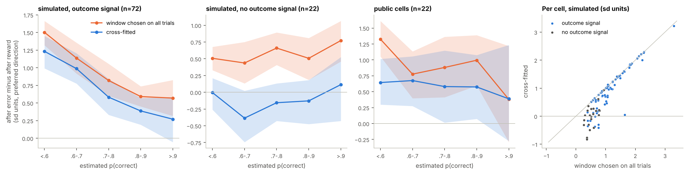

# When neurons seem to predict the next mistake

*Purkinje cells, trial-and-error learning, and a surprisingly easy way to find patterns that aren't there.*

I was looking at recordings from individual neurons in the cerebellum while a monkey learned which hand to use for each of two unfamiliar symbols. The question was straightforward: does a Purkinje cell fire differently after the monkey makes a mistake than after it gets a reward?

At first, the answer seemed to be yes. A conventional analysis flagged 18 of 22 cells in the public recordings.

Then I ran the same test on the outcome of the **next** trial. It flagged 13 cells.

That was the more interesting result. A neuron can't respond to feedback that hasn't happened yet. Future outcomes can still be correlated with the animal's current state, of course, but finding almost as much *future*-outcome selectivity as *previous*-outcome selectivity was a pretty good reason to distrust the original test.


## The problem

A monkey usually makes more errors at the beginning of learning. Meanwhile, a neuron's baseline firing rate can drift over a recording session. Put those together and you get an easy statistical trap: a cell that slowly changes its firing rate can look as though it remembers the last error, even if it doesn't encode reward history at all.

It gets worse when you scan many time windows to find the one with the biggest effect. Neighboring windows overlap, and selecting the best-looking one makes noise look convincing.

I tried a more complicated solution first: fit a behavioral learning model, generate hundreds of synthetic sessions from it, and compare the actual neural activity against those. The approach behaved well in calibration simulations, but the model couldn't reliably capture the irregular ways the monkeys learned in the public data. I didn't want my neural result to depend on a behavioral model I couldn't quite trust.

## What ended up working

The main test uses **local permutations**. Instead of shuffling outcomes across an entire learning block, it shuffles them only within short runs of eight neighboring trials.

This keeps the slowly changing structure of the session largely intact while breaking the fine-scale relationship between a trial's outcome and the neuron's activity. It deliberately gives up information about differences between distant parts of the session, where learning and drift are hardest to separate. The assumption is narrower, not nonexistent: outcomes still need to be reasonably exchangeable within those short runs.

The second idea was to make the same analysis look backward *and* forward in time. Testing the next trial's outcome isn't a proof that every detection is spurious, but it's a useful negative control. If the analysis supposedly finds neurons responding to feedback that hasn't arrived, something else is probably leaking into the result.

The relevant implementation is in [`tools/outcome_tests.py`](tools/outcome_tests.py), and the pipeline runs it from [`scripts/05_outcome_coding.py`](scripts/05_outcome_coding.py). I calibrated several other approaches as well, including ordinary shuffles, circular and linear shifts, trend adjustments, and permutations between sessions. The comparisons are in [the methods notes](docs/methods_notes.md).

## What I found

| Analysis | Previous outcome | Next outcome (control) |
| --- | ---: | ---: |
| Conventional scan of significant windows | 18 / 22 | 13 / 22 |
| Local permutation | 10 / 22 | 2 / 22 |

Those counts are from the 22 usable **public** cells, not the simulated recordings. Nine of the ten previous-outcome detections also survive a 5% false discovery rate correction. The next-outcome count under the local test is consistent with what chance alone could produce at the nominal threshold.

I also tested the methods in simulations where I knew which cells had a real effect and which only had drift. The uncorrected window scan had a 13.5% false-positive rate even without drift, rising to 57.7% in the rate-jump/step-like-learning condition. Local permutation stayed close to the intended 5% level across the tested null conditions, though that calibration only covers the scenarios I simulated.

There was another interesting result: the estimated previous-outcome effect decreases as the monkey learns. To avoid inflating its size by choosing the most responsive time window on the same trials used for measurement, I used cross-fitting. The window is selected on one set of trials, and the effect is measured on others.



## What is in here

The repository has a complete pipeline, from simulated threshold crossings and spike sorting to behavioral fits, neural encoding models, hypothesis tests, and population decoding.

| Part | What it does |
| --- | --- |
| `pcvm/` | Session I/O, the simulator, waveform sorting, GLMs, decoding and plotting |
| `scripts/01_simulate.py` and `02_sort_and_qc.py` | Generate synthetic recordings, separate simple/complex spikes and apply QC |
| `scripts/03_behavior.py` and `04_encoding.py` | Model learning and fit time-resolved neural responses |
| `scripts/05_outcome_coding.py` | Compare outcome tests, including the future-outcome control |
| `scripts/06_learning_timecourse.py` | Estimate how outcome coding changes during learning |
| `scripts/07_population.py` and `08_complex_spikes.py` | Population decoding and simulated complex-spike analysis |
| `tools/` | Standalone learning-curve, outcome-testing and cross-fitting code |
| `results/`, `docs/` | Saved outputs, figures and detailed methods |

The standalone tools are meant to be usable outside this project. For example:

```bash
python tools/outcome_tests.py --demo
python tools/outcome_tests.py --counts counts.npy --trials trials.csv
```

## Running it

```bash
pip install -r requirements.txt
sh run_all.sh
python -m pytest -q tests
```

The shell script runs the numbered stages in order and tries to fetch the public recordings. The bundled, sorted simulated sessions are enough to run stages 03 onward without repeating waveform generation or sorting. The more expensive test calibration is separate:

```bash
python scripts/calibrate_tests.py --redo --blocks
```

## About the data

There are **two distinct kinds of data** in this repository, and it's important not to confuse them.

**Simulated recordings:** `pcvm/simulate.py` generates behavioral trials, spike events and waveforms with known underlying effects and spike identities. The simulation was tuned to approximate selected properties of the public recordings, including learning curves and firing-rate drift. Of 110 generated sessions, 94 passed the sorting/QC criteria. These data are useful for testing a method against ground truth; they are *not* additional experimental neurons.

**Public recordings:** The actual cerebellar recordings are from the Goldberg lab's [Cerebellum_reward](https://github.com/naveen-7/Cerebellum_reward) repository, cited in Sendhilnathan, Ipata & Goldberg (2021). The original file contains 25 cells; I analyze 22 after the exclusions described in [the methods notes](docs/methods_notes.md). The public file is fetched separately rather than redistributed here.

A few caveats matter. The public file comes from a complex-spike study, but the event rates in its rasters are in the simple-spike range, so I've treated them as simple spikes in this analysis. The public sample is small, the trial windows and conventional scan are my implementations rather than exact reproductions of a paper's published pipeline, and a previous-outcome association need not imply that the cell uniquely encodes reward feedback. The complex-spike results here come from simulation only.

For the calibration experiments, more detailed results, references, and the reasoning behind each statistical choice, see [`docs/methods_notes.md`](docs/methods_notes.md).
